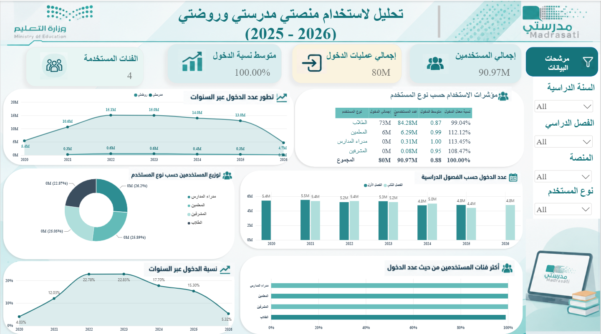

# Educational-Platforms-Usage-Analytics
An interactive Power BI dashboard analyzing educational platform usage, user engagement, login trends, and user distribution across different categories.
# Educational Platforms Usage Analytics

## 📊 Project Overview
An interactive Power BI dashboard designed to analyze educational platform usage and user engagement. The project transforms raw data into meaningful insights through data cleaning, modeling, DAX calculations, and visualization.

## 🎯 Project Objectives
- Analyze educational platform login activity.
- Track login trends across academic years.
- Compare usage across academic semesters.
- Understand user distribution by category.
- Evaluate user engagement through login rates.

## 🛠️ Tools & Technologies
- Microsoft Power BI
- Power Query
- DAX
- Data Modeling
- Data Visualization

## 📈 Key Performance Indicators (KPIs)
- Total Logins
- Total Users
- Login Rate

## 📌 Dashboard Preview

## 🔍 Key Analysis
The dashboard provides insights into:
- Login trends over the years.
- Login activity across academic semesters.
- User distribution by category.
- Login activity by user type.
- Login rate trends over time.

## 👩‍💻 Author
**Nouf Alqarni**

[GitHub Profile](https://github.com/nouf-alqarni)
